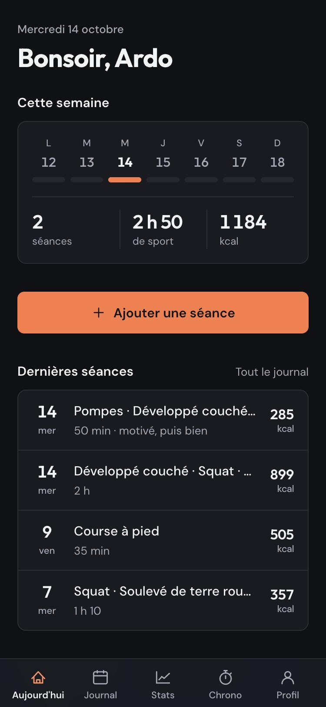
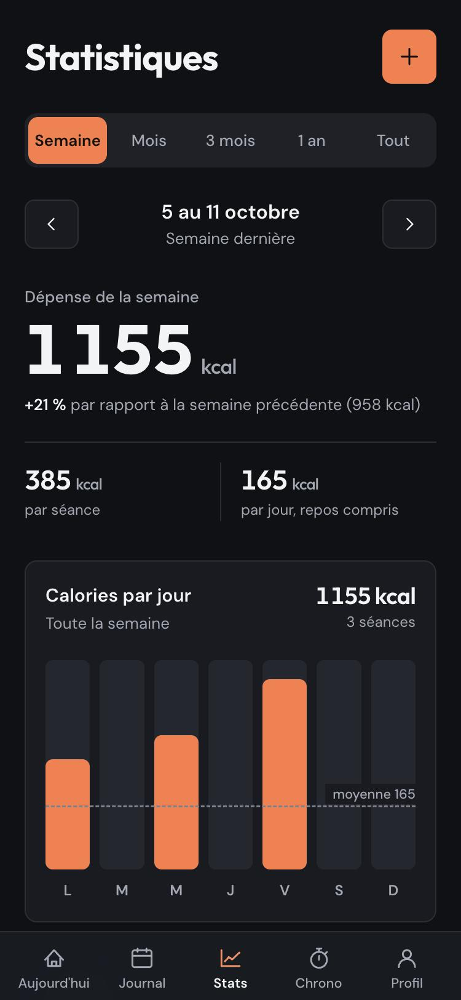
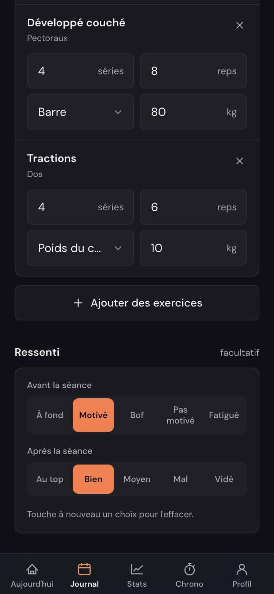
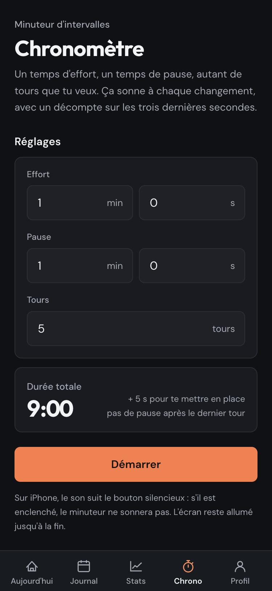

<p align="center">
  
</p>

<h1 align="center">MySport</h1>

<p align="center">
  Un journal d'entraînement personnel.<br>
  On note ses séances en quelques gestes, l'application compte les jours,<br>
  le temps passé et les calories dépensées.
</p>

<p align="center">
  
  &nbsp;
  
  &nbsp;
  
  &nbsp;
  
</p>

<p align="center">
  Next.js 16 · React 19 · Tailwind CSS 4 · Convex · Vercel
</p>

<br>

## Ce qu'elle fait

- **Journal.** Une séance se note en quelques gestes : la date, la durée, puis
  les exercices cochés dans un catalogue d'environ 150 mouvements
  (musculation, gainage, cardio, sports, mobilité). Séries, répétitions,
  matériel et charge sont facultatifs, comme la distance pour le cardio. Un
  exercice absent du catalogue s'ajoute par son nom.
- **Ressenti.** Deux échelles facultatives, avant la séance (de « à fond » à
  « fatigué ») et après (de « au top » à « vidé »).
- **Statistiques.** Semaine par semaine : la dépense comparée à la semaine
  précédente, les calories jour par jour, chaque jour avec ses séances ou son
  repos. Sur un mois, 3 mois, un an ou tout l'historique : les moyennes, une
  barre par semaine, le calendrier du mois, les exercices les plus faits.
  Partout, la part de la dépense qui revient à la musculation et au cardio.
- **Chronomètre.** Un minuteur d'intervalles : temps d'effort, temps de pause,
  nombre de tours. Il sonne à chaque changement, décompte les trois dernières
  secondes et garde l'écran allumé.
- **Poids.** Des pesées datées, notées depuis le profil. Chaque séance s'estime
  avec le poids qu'on faisait ce jour-là.
- **Application.** Installable sur l'écran d'accueil du téléphone ou sur
  l'ordinateur, où elle s'ouvre dans sa propre fenêtre. Thème sombre ou clair.

## Comment les calories sont estimées

Elles ne se saisissent jamais : `kcal = MET × poids × durée`, la formule du
*Compendium of Physical Activities*. Chaque exercice du catalogue
([`convex/data/exercices.ts`](convex/data/exercices.ts)) porte son MET, et
celui de la course se recalcule d'après l'allure quand la distance est notée.

Une séance se découpe en trois sortes de temps :

| Temps | Ce qu'il compte | Intensité |
| --- | --- | --- |
| **Chronométré** | une course, un match : sa durée | le MET de l'activité |
| **Travail** | le temps dans les séries : séries × répétitions × 3 s, ou séries × secondes tenues | le MET de l'exercice, majoré par la charge : soulever en plus l'équivalent de son poids double le coût |
| **Récupération** | le reste de la durée : repos entre les séries, installation | 3,5 MET |

Une série, une répétition ou un kilo de plus transforme donc du repos en
effort, et l'estimation ne peut que monter. La durée de la séance reste le
levier principal.

Le poids retenu est celui **de la date de la séance** : la dernière pesée faite
ce jour-là ou avant, ou la toute première pour une séance plus ancienne que
toutes les pesées. Ajouter, corriger ou supprimer une pesée dans le passé
recalcule les séances qu'elle concerne.

Le même module, [`convex/lib/calories.ts`](convex/lib/calories.ts), sert au
serveur à l'enregistrement et à l'écran de saisie à chaque frappe : le chiffre
annoncé avant d'enregistrer est celui qui s'affiche ensuite.

> Les calories restent une estimation à partir de valeurs moyennes par
> activité, pas une mesure.

## Démarrer en local

```bash
npm install
npx convex dev
```

`npx convex dev` crée le projet Convex, génère `convex/_generated` et écrit
`NEXT_PUBLIC_CONVEX_URL` dans `.env.local` (voir `.env.example`). Il reste à
donner à Convex ses clés d'authentification et l'adresse du site :

```bash
npx @convex-dev/auth
npx convex env set SITE_URL http://localhost:3000
```

La première commande crée une paire de clés (`JWT_PRIVATE_KEY`, `JWKS`) et
l'écrit directement dans le déploiement Convex. Si elle ne peut pas tourner,
`node scripts/generer-cles-auth.mjs` produit les mêmes valeurs, à coller dans
le tableau de bord Convex.

Ensuite, deux terminaux :

```bash
npm run dev       # l'application, sur http://localhost:3000
npx convex dev    # la synchronisation des fonctions Convex
```

## Déployer sur Vercel

La commande de build est fixée par [`vercel.json`](vercel.json) :
`node scripts/deployer.mjs`. À chaque déploiement, ce script :

1. génère les clés de Convex Auth si elles manquent, et seulement dans ce cas :
   les regénérer déconnecterait tous les comptes ;
2. cale `SITE_URL` sur l'adresse du déploiement ;
3. déploie les fonctions Convex, puis construit l'application ;
4. applique les rattrapages de données de
   [`convex/migrations.ts`](convex/migrations.ts).

Un rattrapage sert quand une modification touche des lignes déjà en base. Il
s'écrit une fois, passe au déploiement suivant, laisse son nom dans la table
`migrations` et ne repasse jamais.

Une seule valeur est à saisir dans Vercel (Settings, Environment Variables) :
`CONVEX_DEPLOY_KEY`, à générer dans le tableau de bord Convex (Settings, Deploy
keys). Si elle manque, le journal de build le dit.

## Organisation du code

```
app/
  (app)/            pages connectées : accueil, journal, séance,
                    statistiques, chronomètre, profil
  bienvenue/        premier passage : prénom et première pesée
  connexion/        connexion
composants/         interface : boutons, sélecteurs, listes, choix d'exercices
convex/
  data/             catalogue des exercices et des ressentis
  lib/              calories, poids à une date, session
  seances.ts        lecture et enregistrement des séances
  pesees.ts         pesées, et recalcul des séances qu'elles touchent
  migrations.ts     rattrapages de données au déploiement
  schema.ts         modèle de données
lib/                côté client : dates, totaux, minuteur, sons
scripts/            déploiement, clés d'authentification, icônes
docs/captures/      les captures de ce fichier
```

## Design

Fond graphite, un seul accent orange, des chiffres qui portent la page. Les
titres et les chiffres sont en Outfit, le texte en DM Sans.

- **Des boîtes nettes** pour ce qui se lit d'un bloc (liste, graphique, grille
  de chiffres), avec un titre au-dessus, comme dans les réglages d'un
  téléphone. Angles de 10 px pour les boîtes, 8 px pour ce qu'on touche.
- **Le chiffre principal à même le fond**, très grand, avec deux moyennes en
  dessous.
- **Des choix qui se voient** : onglets, ressentis et thème sont des
  sélecteurs dont l'option retenue est remplie d'orange.
- **Pas d'ornement générique** : ni icône sur pastille teintée, ni étiquette
  arrondie autour de chaque valeur, ni barre de navigation flottante.

Les couleurs vivent dans [`app/globals.css`](app/globals.css) sous forme de
jetons nommés d'après leur rôle (`fond`, `surface`, `creux`, `trait`, `encre`,
`brume`, `accent`). Le thème clair ne change que leurs valeurs, si bien
qu'aucun composant n'a à savoir quel thème est actif. L'accent se dédouble :
`accent` pour les aplats, `accent-texte` pour le texte, qui passe à un orange
brûlé en clair où l'orange vif serait illisible. Un petit script posé en tête
de page applique le thème choisi avant le premier rendu, pour éviter un
éclair de la mauvaise couleur au chargement.

Le logo est [`app/icon.svg`](app/icon.svg). Les PNG qui en dérivent (écran
d'accueil iOS, manifeste) se regénèrent avec `node scripts/icones.mjs` après
toute retouche. iOS garde l'ancienne icône en cache : retirer le raccourci et
le rajouter pour voir la nouvelle.

## Accès et confidentialité

L'application est privée. Il n'y a pas d'écran d'inscription, et la création
de compte est refusée côté serveur dans [`convex/auth.ts`](convex/auth.ts).
Pour ouvrir un compte sur un déploiement neuf, retirer temporairement ce
blocage, se connecter, puis le remettre.

Elle est aussi fermée aux moteurs de recherche : chaque réponse porte
`X-Robots-Tag: noindex, nofollow` ([`next.config.ts`](next.config.ts)), doublé
d'une balise `robots`. Le `robots.txt` laisse volontairement entrer les robots :
un robot à qui l'on interdit la page ne lit pas son « noindex », et peut alors
lister l'adresse seule.
